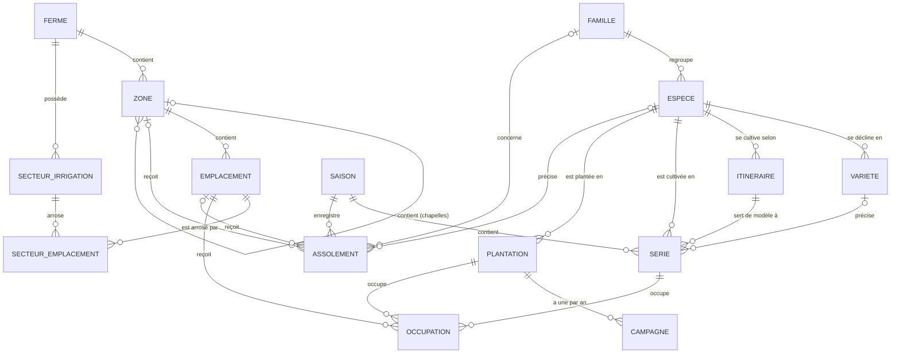
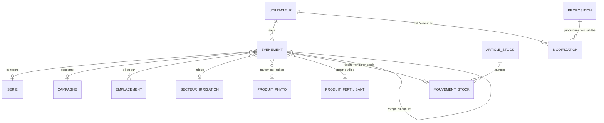

# Modèle de données — v1

Validé par Théophane le 2026-09-25 (critère de sortie de la phase 0). Elle s'appuie sur les réponses Q1 à Q4 de [`questions.md`](questions.md).

Le modèle tient en quatre blocs : **parcellaire**, **bibliothèque**, **planification**, **journal de terrain** (avec stocks et registre phyto). Une planche est une ligne de temps : ce sont les **occupations datées** qui la remplissent. Avec l'**assolement enregistré** sur plusieurs années, elles alimentent le semainier et les alertes de rotation.

## Ce qui est déjà validé

- **Découpage** : ferme → zone → emplacement (planche, rang ou gouttière). L'irrigation est une couche à part : une vanne arrose un ou plusieurs emplacements.
- **Série** : une culture, une date, un itinéraire, une longueur d'emplacement, avec du prévu et du réel. Les pérennes ont une **plantation** pluriannuelle et une **campagne** par an.
- **Saisies au champ** : réalisé, récolte, intervention, irrigation, traitement phyto, observation, plus le **travail du sol**.
- **Assolement** : il se décide selon les cas par zone, par chapelle ou par planche, et il doit être **enregistré sur plusieurs années**, parce qu'on ne remet pas des choux au même endroit avant 4, 5 ou 6 ans.

## Vue d'ensemble

Parcellaire, bibliothèque et planification :



Journal de terrain, stocks, registre phyto et validation :



## 1. Parcellaire

| Entité | Champs principaux | Remarques |
| --- | --- | --- |
| Ferme | nom, fuseau horaire, position (pour la météo), unités | Chaque ligne de chaque table porte `ferme_id` : c'est la frontière de la synchro et de l'export. |
| Zone | nom, zone parente (facultative), type d'abri (plein champ, tunnel, serre, hors-sol), surface, équipements de l'abri (facultatifs, T58) | Un tunnel, une serre, un îlot, le verger. Une zone peut contenir des sous-zones : une serre multichapelle contient ses chapelles, un îlot ses sous-îlots. Équipements (T58, `equipements_abri`, jsonb ; texte JSON en synchro) : liste parmi `ouvrants_lateraux`, `ouvrants_faitage`, `portes`, `chauffage`, `voile`, sans doublon, vide permise ; **nulle = liste par défaut du type d'abri** (serre : les cinq ; tunnel et hors-sol : ouvrants latéraux, portes, voile ; plein champ : aucun ; `equipementsParDefaut`, `@planif/core/abris`). |
| Emplacement | code court, sorte (planche, rang, gouttière), longueur (m), largeur (m), nombre de pains (gouttière, T51), ancien nombre de places (gouttière, lecture seule), actif du / au, remplace (anciens emplacements) | Gouttière (T51) : elle se remplit par contenants (pains, sacs, pots), colonne `nombre_pains` (entier > 0, obligatoire pour une gouttière et seulement elle ; proposé à 1 pain par mètre, longueur arrondie, au moins 1 ; une gouttière reçue sans pains, téléphone d'avant T51 ou import, en reçoit autant du serveur). L'ancien `nombre_places` reste en base, facultatif, en lecture seule, et ne sert plus à aucun calcul ; la migration `0037_emplacement_nombre_pains` a donné à chaque gouttière existante sa longueur arrondie en pains et ramené chaque occupation de gouttière à la même part en pains (max(1, min(pains, arrondi(places × pains ÷ anciennes places)))). Le code (`P3`, `T2-P03`) est unique **dans sa zone** parmi les emplacements non supprimés et en service (une planche retirée, `actif au` renseigné, ne réserve plus son code, même si la date de retrait est encore à venir), sans tenir compte des majuscules ni des espaces autour (Q27) : deux « P3 » dans deux tunnels sont permis, c'est la zone qui les distingue quand la voix reconnaît « planche 3 du tunnel 2 ». Le lien « remplace » garde l'historique de rotation quand on redessine des planches. |
| Secteur d'irrigation | numéro de vanne, nom, débit (facultatif), position sur le plan x, y (facultative, T57), adresse Modbus (phase 3) | Les 60 vannes. Numéro de 1 à 9 999, unique dans la ferme parmi les vannes non supprimées (index partiel, migration 0040). Position dans le repère de la ferme (mètres), les deux ou aucune, à 5 km au plus de l'origine ; sans position, la vanne s'affiche en tête de sa première planche (plus petit code), au bout opposé à son cap. |
| Secteur ↔ emplacement | secteur, emplacement, du / au | Plusieurs emplacements par vanne, éventuellement dans plusieurs zones. Datée pour garder l'historique si le réseau change : actif du `du` au `au` compris ; retirer une planche ferme son lien la veille (un lien né le jour même est supprimé), en ajouter une crée un lien du jour (`changerLiens`, `@planif/core/irrigation`). |

## 1 bis. Placement réel — v1.x (validée le 2026-10-07, Q31)

Validée par Théophane le 2026-10-07 (réponses à Q30 et Q31), posée par T28a. Elle ajoute des colonnes nulles et une table : une ferme qui ne place rien ne change pas.

**Repère local de la ferme** : mètres, x vers l'est, y vers le nord. Son origine est un champ à part, `ferme.origine_plan` (latitude, longitude), distinct de `ferme.position` (météo) : changer la position météo ne déplace pas la ferme. Elle se pose avant tout placement et ne change plus (ni ne s'efface) tant qu'un placement existe (règle du serveur et de la porte, T28s). **Orientation** : cap en degrés, sens horaire depuis le nord, dans [0, 360[.

| Entité | Champs ajoutés | Remarques |
| --- | --- | --- |
| Ferme | origine du plan (latitude, longitude), facultative | Point (0, 0) de toutes les positions en mètres. |
| Zone | contour : liste de sommets `{x, y}` en mètres, facultatif | Polygone libre (Q31), 3 à 200 sommets, rangé en sens antihoraire. Nul : zone pas placée, ou abritée par un bâtiment. |
| Emplacement | position x, position y (m), orientation (°), facultatives | **Dans le repère de sa zone** : bouger la serre bouge ses planches. Les trois nulles ensemble : rangement automatique dans la zone. |
| Bâtiment (nouvelle) | nom, type (serre tunnel, serre chapelle, hangar, local, chambre froide, magasin, autre ; local et chambre froide depuis T61), longueur, largeur, hauteur (m), centre x, y (m), orientation (°), zone abritée (facultative) | Toujours un rectangle, toujours placé. Une serre abrite au plus une zone de sa ferme, et une zone au plus un bâtiment non supprimé. Suppression douce, historique, UUID v7, comme le reste du parcellaire. |

**Serre et zone** : une zone abritée par un bâtiment n'a pas de contour à elle. Sa forme est le rectangle du bâtiment, son repère celui du bâtiment (centre, orientation). Une zone sans bâtiment a son polygone ; son repère est le centroïde de surface du polygone et le cap de son plus long côté, ramené dans [0, 180[ (le premier dans l'ordre des sommets à égalité). Rattacher un bâtiment à une zone qui a un contour : l'écran efface le contour, avec confirmation (T28b) ; la base refuse les deux à la fois.

**Repère d'une zone** : l'axe y' suit la longueur (cap θ), l'axe x' est à sa droite (cap θ + 90°). Les coins d'un bâtiment sont (±largeur/2, ±longueur/2) dans ce repère.

**Exemples chiffrés** (`packages/core/src/placement`, tests à l'appui) :

- Origine à 44° N, 1,5° E : le point 44,000 898 3° N, 1,501 248 8° E est à 100 m au nord et 100 m à l'est, soit (100, 100). Projection locale : x = R·Δλ·cos φ0, y = R·Δφ, R = 6 378 137 m ; aller-retour à moins de 1 cm dans un rayon de 5 km.
- Planche à (2, 0) dans une serre centrée en (50, 30), tournée de 90° (longueur vers l'est) : (50, 28) dans la ferme. La serre déplacée en (150, 30), orientation 0 : la même planche est en (152, 30).
- Zone en L sans serre, sommets (0, 0) (20, 0) (20, 10) (10, 10) (10, 30) (0, 30) : aire 400 m², centroïde (7,5 ; 12,5) (pas la moyenne des sommets), plus long côté nord-sud, orientation 0°.

**Règles d'un placement** (`validerPlacement`, `validerContour`, rejouées par le serveur en T28s) :

- Contour : 3 à 200 sommets aux coordonnées finies, à 5 km au plus de l'origine, pas deux sommets consécutifs à moins de 1 mm (un contour fermé, premier sommet répété, est refusé), pas d'auto-intersection (deux côtés non adjacents sans point commun), aire de plus de 0,1 m². Un contour horaire est rendu antihoraire.
- Emplacement : tout ou rien des trois champs, orientation dans [0, 360[, à 5 km au plus du centre de sa zone.
- Bâtiment : tous les champs obligatoires, dimensions > 0 avec plafonds de 500 m de long, 200 m de large, 30 m de haut, orientation dans [0, 360[, centre à 5 km au plus de l'origine.
- Zone abritée : pas de contour.
- Messages de refus en français.

**Ce que la base rejoue** (migrations 0025 à 0028) : les bornes simples (tout ou rien, orientation, distance, dimensions et plafonds, type, contour : tableau de 3 à 200 objets `{x, y}` numériques à 5 km au plus, texte de 16 384 caractères au plus), la zone d'un bâtiment de la même ferme (clé étrangère composée), un bâtiment non supprimé par zone (index unique partiel), zone abritée sans contour (déclencheurs). La géométrie (auto-intersection, aire, sens) reste au serveur. `origine_plan` n'a pas de bornes en base.

**Droits** : **gérant seulement** pour tout placement (zones, planches, bâtiments, origine du plan), contrôlé par le serveur (T28s, voir « Placement réel écrit par le téléphone » plus bas).

**Synchro et export** : `batiment` descend sur les téléphones avec le même découpage par ferme que `zone` ; l'export ajoute `batiment.csv` et les nouvelles colonnes, décrites dans LISEZMOI.txt.

## 1 ter. Chemins, repères et rangement des outils — v1.x (T61, Q44)

Un nouvel ouvrier trouve son chemin et l'outil de sa consigne sans demander. Cinq tables de ferme (`ferme_id`, horodatages, `supprime_le`, UUID v7) ; une ferme qui n'en a pas ne change pas.

| Table | Colonnes | Rôle |
| --- | --- | --- |
| `chemin` | `nom` (facultatif, 1 à 80 caractères), `points` (jsonb `[{x, y}]` en mètres du repère de la ferme), `largeur_m` (> 0, 20 m au plus) | Chemin tracé point par point : une **ligne ouverte** (elle peut se croiser ou revenir sur elle-même). |
| `point_plan` | `nom` (1 à 80), `sorte` (`point_eau` ou `repere`), `x_m`, `y_m` | Point d'eau ou autre repère nommé (portail, abri). |
| `lieu_rangement` | `batiment_id` **ou** `point_plan_id` (exactement un, même ferme) | Où se rangent les outils. Son nom est celui de son bâtiment ou de son point. Un seul lieu non supprimé par élément. Il ne change pas d'élément : on le retire et on en crée un autre. |
| `place_rangement` | `lieu_rangement_id` (même ferme), `nom` (1 à 60) | Place nommée dans un lieu (« mur nord »), unique dans son lieu sans tenir compte de la casse ni des espaces autour. Elle ne change pas de lieu. |
| `outil` | `nom` (1 à 80), `lieu_rangement_id` (**obligatoire**, même ferme), `place_rangement_id` (facultatif, une place **du même lieu**) | Outil de la ferme. Son nom est unique dans la ferme (sans casse ni espaces autour) : le travail prévu le désigne par ce nom. |

Règles :

- **Cœur** (`packages/core/src/placement/chemins.ts`) : `validerChemin` (2 à 200 points finis, à 5 km au plus de l'origine, pas deux points consécutifs à moins de 1 mm, largeur > 0 et ≤ 20 m), `validerPointPlan`, `validerPlaceRangement`, `validerOutil`. `trouverOutil` retrouve l'outil d'un travail prévu par son nom (sans majuscules, accents ni espaces autour, jamais « le plus proche »). `libelleRangement` donne « Grelinette — hangar, mur nord ».
- **Origine du plan** : aucun chemin ni point actif sans origine. Un chemin ou un point non supprimé **fige** l'origine, comme un bâtiment. Le rangement n'a pas de position : il ne demande pas d'origine.
- **Droits** : le **gérant** actif seul écrit les cinq tables, comme tout le placement. Le serveur (`apps/api/src/sync/plan-chemins.ts`) et la porte du téléphone (`packages/sync/src/plan-chemins.ts`) le vérifient. Tout membre actif reçoit les cinq tables par la synchro. Il n'y a pas de DELETE, seulement la suppression douce.
- **Ce que la base rejoue** (migrations `0044` à `0046`) : la fonction `chemin_points_valides` (tableau de 2 à 200 objets `{x, y}` numériques à 5 km au plus, texte de 16 384 caractères au plus), les bornes des noms, de la largeur, de la sorte et de la distance. La même ferme est garantie par des clés étrangères composées (`batiment` et `point_plan` gagnent `UNIQUE (ferme_id, id)`). Une clé étrangère `(place_rangement_id, lieu_rangement_id)` garantit que la place est dans le lieu de l'outil. Des index uniques partiels portent un lieu par élément et les noms uniques. Les points confondus restent au cœur. Aucune ligne existante n'est réécrite.
- **Pas d'historique** dans `modification` (comme l'équipe). Les cinq tables sont dans l'export (`chemin.csv`, `point_plan.csv`, `lieu_rangement.csv`, `place_rangement.csv`, `outil.csv` ; `points` décodé dans `ferme.json`). Elles ont un stream chacune dans `powersync/sync-config.yaml`, filtré par `fermes_actives`.
- **Écrans** : l'éditeur de placement montre les chemins et en trace de nouveaux (« Tracer un chemin », gérant, ordinateur). La fiche du jour affiche « Grelinette — hangar, mur nord ». Un tap ouvre l'onglet Planches et la 3D (`Rangement3d`) surligne le lieu et la planche, sans calculer de chemin. La 3D pose les chemins au sol, en bandes plates ; un bouton « Étiquettes » affiche à la demande les noms des chemins et des bâtiments.
- **Téléphones pas encore mis à jour** : ils ignorent les nouvelles tables. Ils dessinent un bâtiment `local` ou `chambre_froide` comme « autre » dans le plan ; leur éditeur de placement ne l'affiche pas.

## 2. Bibliothèque de cultures

| Entité | Champs principaux | Remarques |
| --- | --- | --- |
| Famille botanique | nom, délai de retour minimal (années), délai de retour conseillé (années) | Sert aux alertes de rotation. Réglable par ferme. |
| Espèce | nom, famille, catégorie (légume, petit fruit, fruit, fleur, aromatique, engrais vert), pérenne oui/non, unité de récolte par défaut (kg, botte, pièce, barquette), délais de retour propres (facultatifs) | Les engrais verts sont des espèces comme les autres : ils comptent dans la rotation. Les délais de l'espèce remplacent ceux de la famille quand ils sont remplis (choux : 4 ans minimum, 6 conseillés). |
| Variété | espèce, nom, fournisseur, poids de mille graines, taux de germination | |
| Itinéraire technique | espèce, variété (facultative), nom, mode (semis direct, plant maison, plant acheté), période d'usage (semaines), type d'abri, durée en pépinière (jours), durée avant récolte (jours), fenêtre de récolte (jours), façon de compter la densité (écartement, au mètre linéaire, à la volée, en contenants) et ses paramètres (rangs par planche, écartement sur le rang en cm, disposition des rangs à l'écartement : alignés ou en quinconce, graines par mètre, largeur semée, dose en g/m², trous par contenant, plants ou graines par trou), graines par poquet ou par motte, plants par motte, perte en pépinière (%), alvéoles par plaque, marge de sécurité (%), rendement attendu (par m ou par plant) | Pour les pérennes : années avant la première récolte (asperges), période de récolte annuelle, rendement par plant et par an. Le détail des calculs de besoins est dans le ticket T05. Travaux prévus (T22) : liste `travauxPrevus` rangée dans le jsonb `parametres` (catégorie et type d'intervention, repère et décalage en jours, répétition tous les N jours jusqu'à un repère de fin compris, outil, produit et quantité obligatoires en fertilisation et amendement, temps estimé en minutes par 100 m ou par planche), copiée dans l'instantané de la série ; une contrainte CHECK exige un tableau jsonb. Disposition des rangs (T35a) : clé facultative `densite.disposition` du jsonb `parametres`, `alignee` ou `quinconce`, absente = alignés (aucune migration, aucune ligne réécrite) ; elle ne change pas le nombre de plants. Écart entre rangs (T43) : clé facultative `densite.ecartEntreRangsCm` du jsonb `parametres`, à l'écartement et au mètre linéaire, nombre de 5 à 200 cm (refus `hors_bornes` sinon, `champ_invalide` à la volée), absente = l'écran montre l'écart calculé de T42, marqué « ≈ » (aucune migration de schéma, aucune ligne réécrite) ; rangs trop larges pour la planche ((rangs − 1) × écart > largeur) n'est qu'un avertissement à l'écran ; elle ne change pas les besoins (T05) et l'instantané d'une série la recopie. Densité en contenants (T51, hors-sol) : `densite = { facon: 'contenants', trousParContenant, plantsParTrou?, grainesParTrou? }` dans le jsonb `parametres` (aucune migration de schéma) ; trous par contenant entier de 1 à 100 ; en plant maison ou acheté, plants par trou facultatif (absent = 1), de 1 à 20 ; en semis direct, graines par trou obligatoires, de 1 à 50 ; aucune clé des rangs (`cle_inconnue`). Elle ne se compte que sur une gouttière : une série dont l'instantané est en contenants n'occupe que des gouttières (refus `incoherent`, raison `contenants_hors_gouttiere`, sinon). Plants (ou poquets) d'une série = Σ sur ses gouttières de (pains occupés × trous × plants par trou) ; graines en semis direct = ⌈poquets × graines par trou × (100 + marge) ÷ germination⌉, comme T05 ; la série porte ce nombre de plants (`nombre_plants`), pas de longueur. |

La bibliothèque de référence (lignes à `ferme_id` nul) est en lecture seule. Une ferme copie ce qu'elle utilise et l'ajuste chez elle : « Personnaliser » une espèce (T32g), « Adapter pour ma ferme » un itinéraire (T24, T41 : la copie va sur l'espèce de la ferme quand elle a personnalisé celle de la bibliothèque, sinon sur celle de la bibliothèque). Une série peut aussi se créer directement sur un itinéraire de la bibliothèque : son instantané de paramètres est copié dans la série.

**Bibliothèque de départ (T41, Q43).** Une ferme neuve reçoit par la synchro 10 familles, 35 espèces (annuelles) et 46 itinéraires, tirés de `packages/db/bibliotheque/depart.json` :

- **Provenance** : valeurs usuelles arrondies, construites à partir de sources **publiques** citées itinéraire par itinéraire dans le JSON (semenciers, ITAB, GRAB, chambres d'agriculture, réseaux bio régionaux, extensions universitaires) ; chaque itinéraire porte une note « à vérifier ». Aucun contenu payant (décision Q43 : jamais la Masterclass de l'Institut Jardinier-Maraîcher). Hypothèses communes dans `meta` du JSON : planche d'environ 75 cm × 30 m, rendement par mètre linéaire de planche ou par plant, durée avant récolte comptée depuis la mise en place, semaines ISO de mise en place en France tempérée.
- **En base** : migration de données `0032_bibliotheque_depart` (`packages/db/src/bibliotheque.ts`), **figée** depuis T41b : son texte ne change plus jamais (un test compare son empreinte sha256 à une valeur inscrite dans le test). Identifiants fixes dérivés du nom (md5 de `famille:<nom>`, `espece:<nom>`, `itineraire:<espèce>:<nom>`), `ON CONFLICT (id) DO NOTHING` : rejouable sans doublon, et rien ne change pour une ferme qui a ses propres lignes. Une ligne renommée garde son identifiant : le JSON porte alors `nomInitial`, le nom sous lequel elle est entrée, d'où l'identifiant dérive. Les sources et notes « à vérifier » restent dans le JSON du dépôt, pas en base.
- **Conversion** : `periodeUsage` → semaines de début et de fin ; `densite` → écartement (rangs, écartement sur le rang en cm, disposition écrite seulement en quinconce), mètre linéaire ou volée ; `rendementAttendu` en kg par mètre ou par plant ; `margeSecuritePct` et `pertePepinierePct` → pourcentages entiers. Chaque itinéraire est validé par le cœur (`validerItineraire`) et ses bornes vérifiées par les tests avant d'entrer dans la migration.
- **Mise à jour (T41b)** : une valeur changée dans le JSON passe par une NOUVELLE migration de bibliothèque (une migration fusionnée ne se réécrit jamais : sur une base déjà migrée, drizzle ne la rejouerait pas) ; les copies déjà faites par les fermes ne changent pas. Procédure :
  1. Corriger `packages/db/bibliotheque/depart.json` (pour renommer une ligne, écrire son ancien nom dans `nomInitial`, s'il n'y est pas déjà).
  2. `pnpm --filter @planif/db bibliotheque <NNNN_nom>`, avec le numéro qui suit le journal de drizzle (par exemple `0034_bibliotheque_correction_carotte`). Le script écrit `migrations/<NNNN_nom>.sql`, l'état `bibliotheque/etats/<NNNN_nom>.json` (les lignes actives de la bibliothèque après cette migration), l'entrée du journal et l'instantané (comme `drizzle-kit generate --custom`). Il refuse 0032, un numéro qui ne suit pas, une migration existante déjà suivie d'une autre, et un JSON qui ne change aucune ligne de la base. Tant que la migration n'est pas fusionnée, relancer le script sous le même nom la réécrit.
  3. Le SQL ne touche que les lignes changées depuis le dernier état : `INSERT … ON CONFLICT (id) DO UPDATE … WHERE <table>.ferme_id IS NULL AND (…) IS DISTINCT FROM (…)` pour une ligne ajoutée ou modifiée (jamais une ligne de ferme ; une ligne déjà juste n'est pas réécrite ; une ligne retirée puis remise retrouve `supprime_le` nul), `UPDATE … SET supprime_le = now() WHERE ferme_id IS NULL AND supprime_le IS NULL AND id IN (…)` pour une ligne retirée du JSON, qui n'est jamais effacée (des séries peuvent la référencer). Jamais de DELETE. Rejouable sans effet.
  4. `pnpm --filter @planif/db test` : `bibliotheque-suites.test.ts` échoue tant que le JSON courant n'est pas égal à « 0032 + migrations de bibliothèque suivantes » (chaque migration conforme à « état précédent → son état », et le dernier état égal à la conversion du JSON), en nommant les lignes changées et la commande à lancer.
  Première application : `0033_bibliotheque_melon_plein_champ` renomme l'itinéraire du melon « Melon, plein champ (chenille conseillée) » (rangé en plein champ, la chenille dite dans « à vérifier »), même identifiant.
- **Travaux prévus et écartements (T42)** : `0034_bibliotheque_travaux` donne à chacun des 46 itinéraires ses `travauxPrevus` (format du cœur, types de la liste de départ : compost en kg/m² et engrais organique en g/m² avec produit et quantité, grelinette, préparation de planche ou faux semis, paillage, désherbage répété jusqu'au début de récolte, éclaircissage, buttage, palissage, taille, effeuillage, filet anti-insectes en « autre » ; temps estimés non renseignés), copiés tels quels dans `parametres` ; et passe à l'écartement les semis directs de graines comptables (carotte, radis, navet, épinard, haricot nain, pois : rangs, écartement sur le rang, graines par poquet ; le haricot grimpant l'était déjà), les fines graines (mesclun, roquette, aneth, coriandre) restant au mètre linéaire. Mêmes noms et identifiants, aucune famille ni espèce touchée. L'écran Itinéraires affiche, pour une densité à l'écartement ou au mètre linéaire, l'écart entre rangs (largeur de planche / rangs ; largeur la plus fréquente des planches actives de la ferme, sinon 75 cm) et, au mètre linéaire, l'écart moyen équivalent entre graines sur le rang (100 / graines par mètre) : affichage seulement, les besoins restent calculés par le cœur.
- **Écart entre rangs (T43)** : `0036_bibliotheque_ecart_entre_rangs` donne à chacun des 46 itinéraires son `densite.ecartEntreRangsCm` (cm entiers, valeurs usuelles arrondies des fiches publiques déjà citées) : à 2 rangs ou plus, les rangs tiennent sur la planche de 75 cm ((rangs − 1) × écart ≤ 75, rangs × écart de 60 à 90 cm : carotte de conservation 4 rangs à 18 cm, carotte botte 5 à 15, radis et mesclun 6 à 12, laitue 3 à 30, chou pommé 2 à 45…) ; à 1 rang (tomate, aubergine, courges, concombre, melon, pomme de terre), l'entraxe des planches, 120 cm (planche de 75 cm et passe-pied de 45 cm). Mêmes noms et identifiants, rien d'autre ne change. L'écran Itinéraires montre la valeur saisie partout où se voit la densité (liste, lecture, formulaire, schéma des rangs) et, sans elle, l'écart calculé de T42 marqué « ≈ ».
- **Fraise hors-sol (T51)** : `0038_bibliotheque_fraise_hors_sol` ajoute la famille « Rosacées », l'espèce « fraise » et l'itinéraire « Fraise hors-sol en gouttière » (plant acheté, abri hors-sol, densité en contenants, 12 trous par pain, plants frigo de janvier-février, récolte environ 65 jours après sur 75 jours ; sources : essai CTIFL Balandran, Chambre d'agriculture d'Occitanie). 12 trous pour la Gariguette, 10 pour Manon ou Dream : à adapter par variété dans sa copie. 47 itinéraires, 36 espèces, 11 familles ; aucune ligne de ferme touchée.

## 2 bis. Croissance des cultures — v1.x (validée le 2026-10-08, Q32)

Validée par Théophane le 2026-10-08 (réponses 3 à 5 de Q32, option A), posée par T32a. Elle ajoute une colonne nulle : une ferme qui ne règle rien ne change pas.

| Entité | Champ ajouté | Remarques |
| --- | --- | --- |
| Espèce | profil de croissance (`profil_croissance`, jsonb), facultatif | Nul : le profil par défaut de l'espèce, tenu dans le code (`packages/core/src/croissance/defauts.ts`), jamais copié en base. Réglé par la ferme sur **ses** espèces ; la bibliothèque commune n'en porte pas. |

**Profil** (clés camelCase) : `forme` (`erige-tuteure`, `rosette`, `touffe`, `rampant`, `buisson`, `arbre-ou-liane`, `bulbe-ou-racine`), `hauteurMaxM` (plus de 0, 6 m au plus), `duree` jusqu'à la hauteur maximale (`{ en: 'jours', jours }` de 1 à 730, ou `{ en: 'fraction_cycle', fraction }` dans ]0, 1], part du cycle mise en place → fin de récolte), `allure` (`lineaire` ou `en-s`), `finDeCycle` (`conservee` ou `baissee`), `cycleAnnuel` des pérennes (`{ debourrement, repos }` en 'MM-JJ', débourrement avant repos ; nul pour une annuelle), `fougereApresRecolte` (T32c, booléen facultatif, absent = faux : pérennes dont le feuillage ne monte qu'après la fin de la récolte, Q33 ; porté par le profil par défaut de l'asperge, gardé dans un profil réglé par la ferme ; ignoré par les annuelles). Aucune autre clé ; texte de 2 048 caractères au plus.

**Calcul** (`croissanceA`, `croissancePerenneA`, tests à l'appui) : stade (aucun, levée sous 10 % de la hauteur, croissance, pleine production, fin, puis aucun dès l'arrachage) et hauteur d'une occupation à une date, la date réelle remplaçant la prévue ; sans fin de récolte ni arrachage, la hauteur maximale est tenue (aucune fin inventée). Pérennes : débourrement, pleine végétation, repos, sur la campagne de l'année (hors campagne : pas de feuillage) ; sans cycle annuel, « touffe haute fixe ». La hauteur **illustre** la culture dans le jumeau numérique (T32b) : ce n'est ni une prévision de rendement ni une date de récolte.

**Valeurs par défaut** : une par espèce de la bibliothèque commune (rapprochée par nom ou synonyme, sans casse ni accents), plus un profil générique pour une espèce inconnue. Ce sont des ordres de grandeur marqués « valeur usuelle à vérifier », à corriger par Théophane.

**Ce que la base rejoue** (migration 0030) : CHECK « nul ou objet jsonb ». Les bornes du profil sont celles du cœur (`validerProfilCroissance`), rejouées par le serveur.

**Droits** (T32c, Q35) : le profil d'une espèce de sa ferme se règle par le **gérant** actif de la ferme seulement. Le serveur compare, dans la transaction de l'envoi, le profil après l'écriture à celui relu en base (comme profils relus par le cœur) : un équipier qui le change, le crée (espèce créée avec un profil) ou le remet à nul voit tout son envoi refusé, « Saisie non enregistrée, données invalides : seul le gérant peut régler le profil de croissance. » Renvoyer la valeur déjà en base reste permis ; les autres champs de l'espèce gardent les droits ordinaires (tout membre actif, T10s). Profil hors bornes : refusé par le serveur, tout l'envoi avec lui, message en français. Réglage dans l'écran Itinéraires culturaux (bouton « Croissance » de chaque espèce, Q39) ; espèce de la bibliothèque commune : lecture seule.

**Synchro et export** : la colonne descend avec `espece` (texte JSON sur le téléphone) ; l'export la porte dans `espece.csv` (texte JSON, vide = défaut) et `ferme.json` (objet ou null), décrite dans LISEZMOI.txt.

## 3. Planification

| Entité | Champs principaux | Remarques |
| --- | --- | --- |
| Saison | nom (« 2027 »), début, fin | Une série appartient à la saison de sa mise en place. |
| Travail prévu d'itinéraire | type d'intervention, repère (semis en pépinière, mise en place, début ou fin de récolte), décalage en jours, répétition facultative (tous les N jours jusqu'à un repère), outil, produit et quantité facultatifs, temps estimé facultatif (min par 100 m ou par planche) | Rangé dans l'itinéraire (Q22, T22) et copié dans l'instantané de la série. Le semainier en tire les tâches ; un événement « intervention » du même type les solde. |
| Série | espèce, variété, itinéraire, **instantané des paramètres**, ancre (semis, plantation ou début de récolte) + date d'ancre, dates prévues calculées (semis pépinière, mise en place, début et fin de récolte), longueur totale (m) ou nombre de plants, statut | L'instantané fige les paramètres de l'itinéraire à la création : modifier un itinéraire ne réécrit jamais une série passée. |
| Plantation | espèce, variété, date de plantation, nombre de plants, date d'arrachage (vide tant qu'elle est en place) | Kiwis, asperges, pivoines, fraisiers conservés plusieurs années. |
| Campagne | plantation, année, dates de récolte prévues, rendement prévu | Porte la taille, les récoltes et le rendement de l'année. |
| Occupation | emplacement, série **ou** plantation, longueur (m) ou nombre de places (sur une gouttière, des pains depuis T51), position sur la planche (facultative), du / au prévus, du / au réels | Le cœur de la dimension temporelle, voir ci-dessous. |
| Assolement | saison, cible (zone, chapelle ou emplacement), famille ou espèce, nature (prévu, passé saisi, passé importé) | Enregistré, jamais effacé. Il sert à planifier la rotation avant de détailler les séries, et à garder l'historique des années où aucune série n'existe dans l'appli. |

L'ancre permet de planifier à rebours : « je veux des batavias à partir de la semaine 22 » donne la date de plantation et la date de semis en pépinière.

L'assolement enregistré est indispensable dès le premier jour. Quand une ferme arrive, l'appli ne connaît aucune de ses séries passées. Pour savoir que des choux étaient dans la chapelle 3 en 2023, il faut pouvoir le saisir ou l'importer en une ligne, sans recréer la série.

## 4. La dimension temporelle des planches

Trois choses changent avec le temps, et chacune est datée :

1. **Ce qui occupe l'emplacement** : une occupation par série ou plantation, sur un intervalle de dates. La pépinière n'occupe pas la planche ; l'occupation commence à la mise en place et finit à l'arrachage.
2. **L'emplacement lui-même** : actif du / au. Redessiner des planches crée de nouveaux emplacements sans effacer l'historique des anciens.
3. **Le lien avec l'irrigation** : secteur ↔ emplacement, daté aussi.

Exemple d'une planche de 30 m sous tunnel :

```text
T2-P03 (30 m)            S10   S14   S18   S22   S26   S30   S34
 0–30 m  Radis   s.12    ████
 0–15 m  Batavia s.18          ██████████
15–30 m  Batavia s.19             ██████████
 0–30 m  Tomate  s.25                          ████████████████
```

Ce que le moteur en tire :

- **Conflit d'occupation** : deux occupations qui se chevauchent dans le temps et dont les longueurs dépassent celle de la planche (ou dont les positions se recouvrent).
- **Alerte de rotation** : même famille (ou même espèce si elle a ses propres délais) sur le même endroit avant la fin du délai de retour. Le moteur lit, sur plusieurs années, les occupations réelles et l'assolement enregistré, pour la planche elle-même et pour sa chapelle et sa zone. Des choux notés sur toute la chapelle 3 en 2023 concernent donc chacune de ses planches. En dessous du délai minimal, l'alerte est rouge ; entre le minimal et le conseillé, elle est orange.
- **Décalage** : quand un réalisé arrive en retard, les dates prévues restantes de la série et de son occupation glissent d'autant.

Les dates prévues d'une occupation sont recalculées par le moteur à chaque changement de la série, jamais saisies à la main. Elles sont stockées pour que la vue 2D planches × semaines s'affiche vite.

## 5. Journal de terrain

Toute saisie au champ est un **événement** : quoi, où, combien, quand, par qui, et d'où ça vient.

| Champ commun | Remarques |
| --- | --- |
| type | réalisé, récolte, intervention, irrigation, traitement, observation, état d'un abri (`etat_abri`, T58) |
| date et heure, auteur | remplis automatiquement |
| source | tap, voix, agent, photo, import |
| cible | série ou campagne, et/ou un ou plusieurs emplacements, et/ou un secteur d'irrigation |
| note, photos | facultatives ; les photos restent sur le téléphone jusqu'au retour du réseau |

| Type | Où vont les détails | Champs propres |
| --- | --- | --- |
| Réalisé | événement | étape (semis pépinière, semis direct, plantation, arrachage), quantité réelle si différente du prévu |
| Récolte | détail de l'événement (vue `recoltes`) | quantité, unité, catégorie (facultative) |
| Intervention | détail de l'événement (vue `interventions`) | type, outil, produit et quantité pour un amendement ou un engrais (avec, facultatif, `produitFertilisantId` : le produit fertilisant de la ferme choisi, T54), durée d'occupation pour une bâche |
| Irrigation | événement | secteur, durée (min) ; sans culture ni emplacement : les planches arrosées sont celles de la vanne le jour de l'irrigation (liens datés), changer le réseau ne réécrit pas le passé (T57). Fertirrigation (T56), tout facultatif : `recetteFertirrigationId`, `volumeM3` (> 0, au plus 10 000 ; saisi, ou durée × débit de la vanne à la saisie), `ecMesuree` (0 à 20 mS/cm), `phMesure` (0 à 14), `engrais` (doses injectées **figées** à la saisie : produit fertilisant, nom, quantité en kg ou L ; 1 à 20). Une recette exige volume et doses ; des doses sans recette sont refusées (`incoherent`). |
| Traitement phyto | détail de l'événement (vue `traitements`, registre phyto) | produit, dose, surface traitée (m²), cible, opérateur (vide si non précisé) ; date de récolte autorisée = jour du traitement + délai avant récolte du produit, **figée** à la saisie (T52) : jamais avant le jour du traitement |
| Observation | événement | nature (ravageur, maladie, stade, autre), gravité (facultative) |
| État d'un abri (`etat_abri`, T58) | événement | `zoneId` (la serre ou le tunnel), `equipement` (`ouvrants_lateraux`, `ouvrants_faitage`, `portes`, `chauffage`, `voile`), `actif` (booléen : ouverts, allumé, posé ; faux : fermés, éteint, retiré) ; sans culture ni emplacement (`incoherent` sinon). « Ouvrants latéraux ouverts, 9 h » est un tap. L'état courant d'un équipement est le **dernier événement en vigueur** dont l'heure est passée (`etatCourant`) ; une correction prend la place de l'original, à l'heure de l'original ; une annulation retire toute la chaîne (état précédent, ou inconnu). À heure égale entre deux chaînes, le plus grand identifiant d'**original** l'emporte (une correction ne change pas l'ordre) ; original absent du journal : la chaîne vaut à l'heure de son plus ancien maillon présent. Un abri est **ouvert** si un ouvrant ou une porte déclaré est actif ; état inconnu = fermé. |

Réponse à Q10 (2026-09-29) : tous les types sont un seul **événement** du journal, en ajout seul, avec un détail propre au type. Il n'y a pas de tables Récolte, Intervention ni Traitement : les vues SQL `recoltes`, `interventions` et `traitements` les présentent pour les exports et le registre phyto, en ne montrant que la version en vigueur (sans les événements annulés ni ceux remplacés par une correction). Une correction ou une annulation est un nouvel événement de la même ferme et du même type. Détails dans `packages/db/README.md` (T08).

Types d'intervention proposés au départ, modifiables par chaque ferme :

- **Travail du sol** : labour, décompactage, grelinette, rotobêche, herse, buttage, préparation de planche, faux semis.
- **Couverture** : paillage, bâchage ou occultation, solarisation. Une couverture longue réserve l'emplacement : elle crée une occupation.
- **Fertilisation et amendement** : compost, fumier, engrais (produit et quantité, pour le cahier de fertilisation). Le produit est un produit fertilisant de la ferme (T54, section 6) ou un texte libre, compté sans unités ; « Fait » sur un travail prévu garde le texte de l'itinéraire, relié au produit de la ferme de même nom.
- **Entretien** : désherbage, taille, palissage, effeuillage, éclaircissage, autre.

## 6. Stocks et registre phyto

| Entité | Champs principaux | Remarques |
| --- | --- | --- |
| Article de stock | espèce, variété (facultative), unité, catégorie | Ce qui se compte en chambre froide ou au magasin. |
| Mouvement de stock | article, quantité (+ ou −), motif (récolte, vente, perte, ajustement), récolte liée | Une récolte validée crée automatiquement son entrée en stock. |
| Produit phyto | nom commercial, n° AMM, substance active, délai avant récolte (jours), utilisable en bio oui/non, dose maximale | Le registre et l'export pour le contrôle bio se lisent dans les traitements. Produits de la ferme créés, modifiés et archivés (suppression douce) par le téléphone (T52) ; ceux de la bibliothèque commune (ferme_id nul) en lecture seule. |

Registre phyto (T52) : une ligne par traitement **en vigueur** (sans les annulés ni ceux remplacés par une correction) : date, produit, AMM, substance active, bio, dose et unité, surface traitée, emplacements, culture, cible, opérateur, récolte autorisée le. Une seule règle (`lignesRegistrePhyto`, `packages/core/src/phyto`) pour l'écran « Registre phyto » de l'onglet Ferme (saison en cours, filtre bio / non bio) et pour `registre-phyto.csv`, fichier de plus de l'export (colonnes en français), calculé, hors de `ferme.json`.

Délai avant récolte (T52, T69) : un traitement en vigueur interdit la récolte sur ses emplacements du jour du traitement (compris) à la date de récolte autorisée (exclue), **sur ces emplacements seulement** (T69, Q46 : « on peut récolter les autres ») ; un traitement sans emplacement (kiwis, asperges, campagne sans occupation) interdit la récolte de toute sa culture (série ou campagne). Une récolte de la culture sans emplacement, ou sur des emplacements dont une partie seulement est traitée, est alertée et l'alerte nomme les planches interdites (« Récolte interdite sur P3, P4 jusqu’au 13/05 (…) ») ; dans Aujourd'hui, le choix « Planches récoltées » permet alors de ne peser que les planches libres. Une seule règle dans le cœur (`interdictionRecolte`), pour Aujourd'hui, la 3D (T55) et le registre ; plusieurs traitements : la date la plus tardive l'emporte ; une annulation libère, une correction recalcule. Modifier le produit ensuite ne change rien aux traitements passés. Dans Aujourd'hui, une récolte sur un emplacement sous délai affiche « Récolte interdite jusqu'au JJ/MM (Produit, traité le JJ/MM) » et demande une confirmation ; la récolte reste possible, l'avertissement est gardé dans sa note. Une dose au-dessus de la dose maximale déclarée (même unité) est signalée, jamais refusée.

Catalogue e-phy (T53) : la base publique de l'Anses (data.gouv.fr, Licence Ouverte 2.0), réduite par `packages/db/src/ephy` (workflow hebdomadaire « Catalogue e-phy », PR de mise à jour), servie en fichier statique `apps/web/public/ephy/catalogue.json`. **Pas une table** : ni synchronisé, ni dans l'export (ce n'est pas une donnée de la ferme). Forme (`@planif/core/ephy`) : `{ format: 1, source, licence, dateBase, produits }`, chaque produit `{ amm, nom, autresNoms, substances, bio, retire, retireLe, usages }`, chaque usage `{ culture, mode, cible, dose, dar }` (DAR en jours, null si e-phy ne le donne qu'en stade BBCH ou pas du tout). Gardés : produits phytopharmaceutiques autorisés (usages autorisés seulement) et retirés depuis moins de 3 ans (tous leurs usages, « retiré le … »). Chargé au premier usage de la recherche dans la fiche produit, gardé dans la Cache API du navigateur (hors du précache du service worker). Un tap remplit la fiche du produit de la ferme (T52), qui reste la seule donnée écrite ; le DAR est proposé quand les usages des espèces cultivées (séries et plantations) sont d'accord, sinon l'utilisateur choisit l'usage.

### Cahier de fertilisation (T54, Q44)

| Entité | Champs principaux | Remarques |
| --- | --- | --- |
| Produit fertilisant (`produit_fertilisant`) | nom (1 à 200 caractères), forme (solide, liquide), unité (kg, t, L, m3), teneurs N, P₂O₅, K₂O en % (facultatives, 0 à 100), azote d'origine organique oui/non, utilisable en bio oui/non, source (300 caractères au plus), densité en kg/L (`densite_kg_par_l`, T72, facultative, de 0,5 à 2,5, liquides seulement) | Toujours de la ferme (`ferme_id` obligatoire) : pas de bibliothèque commune. La liste de départ (`FERTILISANTS_DEPART`, `packages/core/src/npk/`) est copiée dans la ferme en un tap, puis modifiable. Créés, modifiés et archivés (suppression douce) par le téléphone. |
| Option de la ferme | `ferme.zone_vulnerable_nitrates` (booléen, faux par défaut) | Cochée : plan prévisionnel et alerte de plafond dans le cahier. Décochée : ni l'un ni l'autre. |
| Recette de fertirrigation (`recette_fertirrigation`, T56) | nom (1 à 200 caractères), taux d'injection en % (plus de 0 à 100, facultatif), engrais (jsonb, tableau de 1 à 20 `{ produitFertilisantId, quantite: { valeur, unite } }`, kg ou L, un produit une fois), EC cible (0 à 20 mS/cm) et pH cible (0 à 14), facultatifs | Toujours de la ferme. Taux donné : quantités pour 1 000 L de solution mère injectée à ce taux (1 % = 10 L de mère par m³ d'eau) ; sans taux : quantités par m³ d'eau. Chaque engrais est un produit fertilisant de la ferme (ses teneurs font le bilan). Créées, modifiées et archivées par le téléphone ; règles `validerRecetteFertirrigation` (`packages/core/src/npk/fertirrigation.ts`), mêmes bornes en base (CHECK). |

Teneur : % de la masse du produit tel qu'apporté. Un liquide compté en L ou m³ pèse volume × densité (T72, ci-dessous) ; sans densité renseignée, 1 kg/L est supposé. Un solide saisi en L ou m³ (densité inconnue) est compté sans unités. Les teneurs ne sont **pas figées** dans l'apport (contrairement au délai avant récolte d'un traitement) : corriger un produit après une analyse corrige le bilan de ses apports passés.

Liste de départ : teneurs moyennes d'azote tirées de la seule fiche technique 19 « Composition des effluents » de la DRAAF Auvergne-Rhône-Alpes (mise à jour du 15/07/2025, d'après CORPEN, IPT, ITAVI et, pour les engrais utilisables en bio, ITAB, *Guide des matières organiques*, tome 2, 2001) : fumier de bovin 0,55 %, compost de fumier de bovin 0,8 %, fumier de cheval 0,62 %, corne broyée 12,2 %, farine de plumes 10,1 %, sang séché 11,4 %, guano 16 %, tourteau de ricin 5,7 %. Sans teneur : compost de déchets verts (la fiche renvoie à l'analyse du lot) et vinasse (valeur citée douteuse). P₂O₅ et K₂O laissés vides, faute de source publique sûre. Source et date dans le champ `source` de chaque produit.

Bilan (`bilanFertilisation`, `packages/core/src/npk/`) : unités = quantité en kg (t × 1 000, L × densité du liquide, m³ × 1 000 × densité ; densité 1 si non renseignée, T72) × teneur ÷ 100, ramenées en kg/ha sur la surface des emplacements de l'apport (somme longueur × largeur ; une largeur manquante : kg comptés, kg/ha inconnus), totalisées par emplacement et par période (la saison de la ferme qui contient le jour, à défaut l'année). Seuls les apports **réalisés en vigueur** comptent ; les **prévus** (occurrences des travaux prévus fertilisation et amendement des séries prévues ou en cours, non soldées) s'affichent à part. Un apport sans produit de la ferme, sans teneur ou dans une unité inconnue est compté « sans unités ». Arrondi au centième, une seule fois. Aucune dose n'est conseillée : on mesure.

Zone vulnérable (`alertesAzoteOrganique`) : alerte non bloquante quand l'azote d'origine organique d'un emplacement dépasse **170 kg N/ha** sur l'année civile, réalisé (`realise`) ou réalisé + prévu (`prevu`). Repère par planche : le plafond réglementaire se calcule sur la SAU de l'exploitation.

Écrans : onglet Ferme, carte « Fertilisation » : « Produits fertilisants » et « Cahier de fertilisation » (bilan par planche de la saison, fiche « Fertilisation » d'une planche avec ses apports, et le plan prévisionnel en zone vulnérable) ; Aujourd'hui : bouton « Fertilisation » (planches, produit au doigt ou texte libre, quantité). Export : `produit_fertilisant.csv` (table) et `cahier-fertilisation.csv` (une ligne par apport réalisé en vigueur, colonnes `COLONNES_CAHIER_FERTILISATION`), calculé, hors de `ferme.json`. Fertirrigation (T56) : onglet Ferme, « Recettes de fertirrigation » ; Aujourd'hui, « Fertirrigation » à côté d'« Irrigation » (même saisie, chargée à la demande).

Densité des engrais liquides (T72) : `produit_fertilisant.densite_kg_par_l`, facultative, nombre de **0,5 à 2,5** kg/L (refus `hors_bornes` « densité : de 0,5 à 2,5 kg/L », `champ_invalide` si ce n'est pas un nombre), réservée à la forme liquide (`incoherent` sur un solide ; CHECK en base `produit_fertilisant_densite`, migration `0043_densite_engrais`, générée). Un liquide compté en L ou m³ pèse volume × densité : 100 L à 10 % N de densité 1,25 → 125 kg → 12,5 kg N. Sans densité, 1 kg/L comme avant T72 (aucun bilan existant ne change) et `ApportCalcule.densiteSupposee` est vrai (liquide en volume, avec teneurs) : le cahier écrit « densité non renseignée… » sous l'apport, la saisie et les recettes affichent « densité non renseignée : 1 kg/L supposé ». Un solide saisi en L ou m³ reste compté sans unités et l'écran avertit (saisie d'un apport, recette) : « produit solide saisi en volume : pas d'unités comptées, saisissez en kg ou t » ; la valeur n'est pas refusée. La densité n'est pas figée dans l'apport (comme les teneurs) : la corriger corrige le bilan passé, fertirrigations comprises (`unitesFertirrigation`, bilan). Fiche produit : champ « Densité (kg/L) » (clavier décimal) visible pour la forme liquide seulement ; repasser en solide l'efface. Export : colonne `densite_kg_par_l` de `produit_fertilisant.csv`. La table est déjà dans la publication `powersync` et son flux est un `SELECT *` : ni l'une ni l'autre ne change (garde-fou T67 vert).

Fertirrigation (T56, Q44 : hors-sol et parfois pleine terre, seule la vanne compte) : dose de chaque engrais = quantité × taux ÷ 100 × volume (taux donné) ou quantité × volume (par m³), au milligramme, figée dans le détail de l'irrigation (`detailFertirrigation`) : modifier ou archiver une recette ne réécrit pas le passé. Le bilan et le cahier de T54 comptent chaque irrigation **en vigueur** qui porte des engrais : un apport de catégorie `fertirrigation` par engrais, sur les emplacements que la vanne arrosait **le jour de l'irrigation** (liens datés non supprimés), avec le calcul de T54 (teneurs actuelles, solide compté en L sans unités, kg/ha sur la surface des emplacements, ce qui revient à répartir les kg au prorata des surfaces). `repartitionAuProrata` donne la part de chaque planche au gramme (somme exacte), `unitesFertirrigation` les kg apportés au gramme. Une irrigation sans recette ne compte rien. Exemple : 10 kg de nitrate de calcium (15,5 % N) pour 1 000 L de mère, injection 1 %, 2 m³ d'eau → 0,2 kg de nitrate, 0,031 kg N (le ticket écrivait 0,31 : c'est la valeur à 10 %), sur 50 et 150 m² : 8 et 23 g N, 1,55 kg N/ha chacune. Pas de pilotage des vannes (phase 3). Export : `recette_fertirrigation.csv`.

Le stock n'est jamais un compteur stocké : c'est la somme des mouvements. Deux téléphones hors ligne ne peuvent donc pas se contredire.

## 7. Validation, historique et règles transversales

- **Propositions** : tout ce qui vient de la voix, de l'agent ou d'une photo est d'abord une *proposition* (liste de changements, statut en attente, validée ou rejetée). Rien n'entre dans les tables réelles avant le tap de validation.
- **Journal des modifications** : chaque création, modification ou suppression garde qui, quand, avant, après, et la proposition d'origine. C'est l'historique consultable par l'utilisateur, et ce qui rend chaque action annulable.
- **Identifiants** : UUID v7 générés sur le téléphone, pour créer des lignes hors ligne sans collision.
- **Suppression douce** : une ligne supprimée est marquée, pas effacée. La synchro et l'annulation en ont besoin.
- **Événements en ajout seul** : un événement ne se modifie pas, il se corrige par un nouvel événement ou s'annule. C'est ce qui rend la synchro hors ligne sans conflit sur le journal.
- **Unités** : mètres, jours, kilos. L'interface parle en semaines ; le stockage reste en dates.
- **Export** : chaque table en JSON et en CSV, sans condition.

### Parcellaire et catalogue écrits par le téléphone (T10s)

Le serveur (`apps/api/src/sync/structure.ts`, règles de ligne dans `structure-lignes.ts`) accepte ce qu'un téléphone crée ou modifie, hors ligne compris (import de T14b, écrans de structure) :

- **Tables** : zone, emplacement, saison, assolement (toujours d'une ferme) ; famille, espèce, variété seulement pour les lignes **de la ferme**. Une ligne de la bibliothèque commune (`ferme_id` nul) n'est jamais créée, modifiée ni supprimée par un téléphone : elle se comporte comme une ligne inexistante.
- **Droits** : les mêmes que pour les séries, tout membre actif de la ferme (gérant ou équipier). Un membre retiré ou un invité qui n'a pas encore accepté n'écrit rien.
- **Isolement** : `ferme_id` ne change jamais. Zone parente, zone d'un emplacement, emplacements remplacés, saison, zone et emplacement d'un assolement : de la même ferme. Famille d'une espèce, espèce d'une variété, famille et espèce d'un assolement : de la ferme ou de la bibliothèque. Une ligne d'une autre ferme, même une autre ferme du même utilisateur, compte comme introuvable. Une ligne écrite plus haut dans le même envoi se désigne (import).
- **Validation** : contraintes du schéma rejouées avant l'écriture (noms non vides de 200 caractères au plus comme une cellule d'import, listes fermées, longueurs et surfaces > 0, gouttière ⇔ nombre de pains (T51 ; l'ancien nombre de places, facultatif, seulement pour une gouttière), périodes dans l'ordre, délai de retour minimal ≤ conseillé, germination 0–100 %, assolement à une seule cible, origine d'import réservée au passé importé, dates réelles de 1900 à 2100), plafonds contre les fautes de frappe (10 km de long, 1 000 m de large, 1 000 ha, 1 000 000 de places ou de pains, 100 ans de délai, 100 kg pour mille graines, 200 emplacements remplacés), pas de boucle dans l'arbre des zones, espèce d'un assolement de la famille de l'assolement.
- **Tout ou rien** : un envoi qui touche ces tables est accepté ou refusé en entier, avec les séries, itinéraires, événements et le stock qu'il contient.
- **Suppression** : douce seulement (`supprime_le`), refusée tant que la ligne sert encore, jamais en cascade (T10t, décision du chef). Emplacement : occupation non supprimée d'une série prévue ou en cours non supprimée, ou d'une plantation en place (sans date d'arrachage, ou arrachage prévu après la date du jour) ; assolement actif d'une saison non terminée. Espèce : série prévue ou en cours, plantation en place, variété ou itinéraire actifs de la ferme, assolement actif d'une saison non terminée. Variété : série prévue ou en cours, ou plantation en place. Zone : emplacement ou sous-zone non supprimés, assolement actif d'une saison non terminée. Famille : espèce de la ferme non supprimée, assolement actif d'une saison non terminée qui la désigne (même sans espèce). Saison : série prévue ou en cours, ou assolement actif de son plan, qu'elle soit terminée ou non. Une série terminée, abandonnée ou supprimée ne retient rien. Le message de refus compte ce qui bloque (« 2 assolements », « 1 variété et 2 itinéraires »).
- **Saison terminée** : sa date de fin est strictement avant la date du jour dans le fuseau de la ferme (Europe/Paris), à l'heure du serveur ; en cours (y compris le jour de sa fin) ou à venir, elle est non terminée. Les assolements d'une saison terminée sont l'historique : ils restent actifs et rattachés à la zone, l'emplacement ou l'espèce supprimés, et n'empêchent rien.
- **Seules comptent** les lignes actives de la même ferme ; une ligne supprimée plus haut dans le même envoi ne compte plus.
- **Assolement changé de saison** : il revérifie toutes ses références comme un rétablissement (zone, emplacement, espèce actives, famille égale à la famille actuelle de l'espèce) : un assolement passé dont la ligne a été supprimée, ou dont l'espèce a changé de famille, ne revient pas tel quel dans le plan.
- **Prolonger une saison terminée** (sa fin passe d'avant le jour à ce jour ou après) : refusé tant que des assolements actifs de son plan désignent une zone, un emplacement, une espèce ou une famille supprimés, ou une espèce dont la famille n'est plus la leur ; le message compte ces assolements.
- **Famille d'une espèce** : elle est copiée dans l'assolement (`assolement.famille_id`, l'historique garde la famille de l'époque). La changer est refusé tant que des assolements actifs d'une saison non terminée désignent l'espèce ; une modification qui ne change pas la famille reste acceptée.
- **Historique** : une ligne `modification` par ligne touchée (création, modification, suppression), écrite par le serveur.
- **Série réactivée** : une série terminée ou abandonnée qui redevient prévue ou en cours est revérifiée comme un rétablissement (saison, espèce, variété actives, emplacements de ses occupations non supprimés).
- **Code d'emplacement unique par zone** (Q27, T10t) : index unique partiel `(ferme_id, zone_id, lower(trim(code))) WHERE supprime_le IS NULL AND actif_au IS NULL` (migration 0029, aucune ligne réécrite ; le code est gardé tel que saisi). Le serveur refuse proprement un doublon dans la même zone (création, deux créations dans le même envoi, changement de code ou de zone, rétablissement d'un emplacement dont le code a été repris) : « ce code existe déjà dans cette zone ». Remettre en service une planche retirée dont le code a été repris : refusé aussi. Même code dans une autre zone, ou après suppression ou retrait du premier (avant ou plus haut dans le même envoi) : accepté. Échanger deux codes passe par un code temporaire. À l'import, un doublon donne une ligne « doublon » dans l'aperçu, non écrite, sans refuser l'import.

### Placement réel écrit par le téléphone (T28s)

Le serveur (`structure.ts`, `structure-lignes.ts`, `structure-origine.ts`) accepte le placement fait sur un appareil, hors ligne compris ; la porte (`porte.placer`, `packages/sync/src/placement.ts`) rejoue les mêmes règles avant d'écrire et rend de quoi annuler.

- **Ce qui s'écrit** : `batiment` (création, modification, suppression douce et rétablissement ; pas de DELETE) ; `zone.contour` ; `placement_x_m`, `placement_y_m`, `orientation_deg` d'un emplacement ; de `ferme`, **seulement** `origine_plan` (toute autre colonne refusée ; une ferme ne se crée ni ne s'efface par la synchro).
- **Droits (Q31)** : gérant actif de la ferme de la ligne, rôle relu à chaque envoi. Un équipier qui crée, modifie ou supprime un bâtiment, pose, redessine ou efface un contour, place, déplace ou range une planche, ou pose l'origine, rétablit une ligne placée ou change la zone d'une planche placée : refusé (« seul le gérant peut placer les éléments de la ferme »). Reste ouvert à tout membre : créer une zone ou une planche sans placement, les modifier sans toucher au placement, les supprimer (règles de T10s), et renvoyer à l'identique une ligne placée (rien n'est écrit).
- **Isolement** : comme T10s ; la zone d'un bâtiment est de sa ferme (une zone d'une autre ferme, même du même utilisateur, est introuvable). Une ferme dont on n'est pas membre actif est introuvable.
- **Validation** : `validerPlacement` et `validerContour` du cœur, sur la ligne complète. Contour reçu en texte JSON de 16 384 caractères au plus, mesuré avant de le lire (sinon refusé sans être parcouru), rangé en sens antihoraire, x et y seulement. Bâtiment : nom, type, dimensions, centre et orientation ; sa zone est non supprimée, sans contour, et sans autre bâtiment non supprimé. Contour refusé sur une zone abritée.
- **Origine du plan** (décision du chef) : **aucun placement sans origine** : un bâtiment, un contour ou un emplacement placé est refusé tant que `ferme.origine_plan` est nulle (supprimer, effacer ou ranger reste permis). L'origine ne se pose, ne se modifie ni ne s'efface que si la ferme n'a aucun placement (bâtiment non supprimé, zone non supprimée avec contour, emplacement non supprimé placé). Un envoi est jugé dans l'ordre : origine puis premier bâtiment passe, l'annulation en ordre inverse (bâtiment supprimé, puis origine effacée) aussi ; bâtiment puis origine est refusé. Même règle dans la porte.
- **Suppression** : supprimer le bâtiment d'une zone la laisse telle quelle (elle redevient « pas placée ») ; supprimer une zone abritée par un bâtiment non supprimé est refusé (supprimer ou détacher le bâtiment d'abord, éventuellement plus haut dans le même envoi).
- **Tout ou rien et concurrence** : `batiment` et `ferme` rejoignent les envois tout ou rien, écrits sous le verrou de chaque ferme touchée ; interblocage ou échec de sérialisation : erreur à réessayer (5xx), jamais un refus définitif.
- **Historique** : une ligne `modification` par ligne touchée (`Batiment`, `Zone`, `Emplacement`, `Ferme`).

### Vannes écrites par le téléphone (T57)

Le serveur (`structure.ts`, `structure-lignes.ts`) accepte `secteur_irrigation` et `secteur_emplacement` comme le parcellaire (T10s) : PUT, PATCH (suppression douce, rétablissement), jamais de DELETE, tout ou rien avec le reste du lot, sous le verrou de la ferme, une ligne `modification` par ligne touchée (`SecteurIrrigation`, `SecteurEmplacement`).

- **Colonnes** : vanne : numéro, nom, débit, `placement_x_m`, `placement_y_m` (l'adresse Modbus n'est pas écrite par le téléphone) ; lien : vanne, emplacement, du, au.
- **Droits** : tout membre actif déclare ses vannes et coche ce qu'elles arrosent ; poser, déplacer ou retirer une vanne du plan est un placement (Q31) : gérant seulement, jamais sans origine du plan, et une vanne placée fige l'origine comme les autres placements. Côté téléphone : `porte.placer` (`{ sorte: 'vanne', id, position }`) rejoue les mêmes règles.
- **Validation** : règles du cœur (`@planif/core/irrigation` : `validerVanne`, `validerPositionVanne`), fin d'un lien ≥ son début ; numéro unique dans la ferme ; vanne et emplacement d'un lien de la ferme et non supprimés (une ligne d'une autre ferme est introuvable) ; deux liens non supprimés de la même vanne au même emplacement ne se chevauchent pas.
- **Suppression** : une vanne qui arrose encore (lien non supprimé sans fin, ou fini aujourd'hui ou après) ne se supprime pas ; un lien fermé plus haut dans le même lot ne la retient plus.

### Produits phyto écrits par le téléphone (T52)

Le serveur (`apps/api/src/sync/phyto.ts`) accepte les produits phyto **de la ferme**, hors ligne compris :

- **Écritures** : PUT (création), PATCH (modification ; archiver = `supprime_le`, rétablir = `supprime_le` nul). DELETE refusé. Tout ou rien avec le reste du lot, sous le verrou de la ferme.
- **Droits** : tout membre actif (gérant ou équipier), comme les itinéraires.
- **Isolement** : un produit de la bibliothèque ou d'une autre ferme se comporte comme introuvable ; `ferme_id` ne change jamais.
- **Validation** : `validerProduitPhyto` du cœur, sur la ligne complète : nom de 1 à 200 caractères, AMM de 40 au plus (vide permis : purin, produit sans AMM), substance de 200 au plus, délai avant récolte entier de 0 à 365 jours, bio 0/1, dose maximale nulle ou valeur > 0 (100 000 au plus) avec une unité de 20 caractères au plus.
- **Traitement** (événement) : en plus des règles de T10b, la date de récolte autorisée n'est jamais avant le jour du traitement ; un produit archivé n'est plus accepté pour un nouveau traitement (les anciens le gardent).
- **Historique** : une ligne `modification` par écriture (`ProduitPhyto` ; création, modification, suppression).
- **Téléphone** : index local `ferme_type` (`ferme_id`, `type`, `date`) sur `evenement`, pour lire les traitements sans parcourir le journal (aucune migration serveur).

### Produits fertilisants écrits par le téléphone (T54)

Le serveur (`apps/api/src/sync/fertilisation.ts`) accepte les produits fertilisants **de la ferme** comme les produits phyto (T52) :

- **Écritures** : PUT (création ; la liste de départ part en un lot), PATCH (modification ; archiver = `supprime_le`, rétablir = `supprime_le` nul). DELETE refusé. Tout ou rien avec le reste du lot, sous le verrou de la ferme.
- **Droits** : tout membre actif. **Isolement** : le produit d'une autre ferme se comporte comme introuvable ; `ferme_id` ne change jamais et n'est jamais nul.
- **Validation** : `validerProduitFertilisant` du cœur, sur la ligne complète ; mêmes bornes en base (CHECK).
- **Apport** (événement intervention) : `detail.produitFertilisantId`, s'il est là, désigne un produit de la ferme, archivé compris (apport fait hors ligne avant l'archivage) ; sinon refusé.
- **Option de la ferme** : PATCH de `ferme.zone_vulnerable_nitrates` (0/1) par tout membre actif (`structure-origine.ts`), à côté de l'origine du plan (gérant seul) ; toute autre colonne de `ferme` reste refusée.
- **Historique** : une ligne `modification` par écriture (`ProduitFertilisant`, `Ferme`).
- **Migration** `0041_fertilisation` (générée, avec l'ajout à la publication `powersync`) ; stream `produit_fertilisant` dans `powersync/sync-config.yaml`.

### Recettes de fertirrigation écrites par le téléphone (T56)

Le serveur (`apps/api/src/sync/fertirrigation.ts`) accepte les recettes **de la ferme** comme les produits fertilisants (T54) : PUT, PATCH (archiver, rétablir), jamais de DELETE ; tout membre actif ; tout ou rien avec le lot, sous le verrou de la ferme ; `validerRecetteFertirrigation` sur la ligne complète ; chaque engrais désigne un produit fertilisant de la ferme (archivé compris), sinon refusé ; une recette d'une autre ferme se comporte comme introuvable ; historique `RecetteFertirrigation`. Irrigation : `detail.recetteFertirrigationId` et les produits de `detail.engrais` désignent des lignes de la ferme, archivées comprises (saisie hors ligne avant l'archivage), sinon refusée. Migration `0042_fertirrigation` (générée, avec l'ajout à la publication `powersync`) ; stream `recette_fertirrigation`.

### État des serres écrit par le téléphone (T58)

Pas de nouvelle table : un type d'événement `etat_abri` et une colonne `zone.equipements_abri`. Migration `0047_etat_abri` (générée, sans perte : une colonne nullable, le CHECK de type étendu ; aucune ligne réécrite) ; flux `zone` et `evenement` inchangés (`SELECT *` filtrés par ferme), publication inchangée.

- **Base** : CHECK `evenement_detail_etat_abri` (`zoneId` texte au format uuid, équipement connu, `actif` booléen JSON) ; CHECK `zone_equipements_abri` (nul, ou tableau de noms connus sans doublon, sans sous-requête). Que la zone soit de la ferme et déclare l'équipement : au serveur (jsonb, pas de clé étrangère).
- **Serveur** (`apps/api/src/sync/etat-abri.ts`) : tout membre actif (on ferme la serre le soir sans être gérant). La zone du détail est relue **dans la ferme de l'événement**, dans la requête du verrou : une zone d'une autre ferme, même d'une autre ferme du même utilisateur, est introuvable (`ecriture_invalide`) ; une zone supprimée reste acceptée (saisie hors ligne avant la suppression). Une saisie nouvelle vise un équipement **déclaré** (`equipementsDeZone`). Une correction ne change que l'état : même zone et même équipement que l'original (`correctionEtatAbriPermise`), sinon refusée (on annule puis on ressaisit). Une annulation n'est soumise ni à l'une ni à l'autre règle, pour qu'un tap reste annulable après un changement de liste. Un lot qui porte un `etat_abri` est tout ou rien.
- **Zone** : `equipements_abri` s'écrit avec la zone (PUT, PATCH, tout membre actif, `validerEquipementsAbri` du cœur, texte JSON de 400 caractères au plus). Un téléphone d'avant T58 ne l'envoie pas : son PUT crée une zone à liste nulle, son PATCH garde la valeur en base. Retirer un équipement de la liste n'efface aucun événement.
- **Téléphone** : la porte passe un `etat_abri` par `validerSaisie` avant de l'écrire.
- **Écrans** : Aujourd'hui, bouton « Serres » (panneau « État des serres », un bouton par équipement déclaré, un tap = un événement, « Annuler ») et, à partir de 18 h à l'heure de la ferme, le rappel « 2 serres encore ouvertes » (`rappelDuSoir`) ; vue 3D, un repère par abri (ouvert ou fermé, pastilles chauffage et voile), la même fiche d'équipements, ouvrants relevés et porte ouverte dessinés, filtre « Serres » (ouvert en couleur vive). Liste d'équipements : pas encore d'écran pour la modifier (point ouvert).
- **Export** : `zone.csv` (colonne `equipements_abri`, vide = défaut du type) et `evenement.csv` (événements `etat_abri`, annulations comprises).

## 7 bis. Équipe et consignes — v1.x (T60, Q36 et Q44)

Le gérant attribue les travaux du jour à des personnes de l'équipe ; chacun voit les siens dans Aujourd'hui et numérotés dans la 3D.

| Table | Colonnes | Rôle |
| --- | --- | --- |
| `personne` | `ferme_id`, `prenom` (1 à 60 caractères), `membre_id` (facultatif, vers `membre`), horodatages, `supprime_le` | Une personne de l'équipe, avec un prénom affiché. Une personne active au plus par membre. |
| `attribution` | `ferme_id`, `personne_id`, `cle_tache` (1 à 200 caractères), horodatages, `supprime_le` | Un travail du jour attribué à une personne : une ligne par (travail, personne). |

**Pourquoi une table `personne` liée facultativement à un membre** (règle 1 : un ouvrier sans téléphone, prénom seul) : c'est le modèle le plus simple qui couvre les deux cas. Un membre est un compte, avec une adresse e-mail et des droits ; on ne peut pas créer un membre sans compte, et on ne veut pas de faux comptes. La personne porte le prénom qui s'affiche ; un équipier qui a l'appli est relié à sa personne par `membre_id`. Le gérant l'y relie depuis l'écran Équipe, grâce au code que l'équipier lit sur son téléphone (les 4 derniers caractères de l'id de son membre). Ni les noms ni les e-mails des collègues ne descendent sur les téléphones.

**Pourquoi désigner le travail par la clé de sa tâche** : les travaux du jour sont calculés, pas stockés (le semainier, section 8). La clé de la tâche dans Aujourd'hui (`<série ou campagne>:<étape>` ou `<série>:travail:<indice>:<date prévue>`) est stable tant que la tâche n'est pas faite : il n'y a rien à recalculer en base. Une tâche faite disparaît pour tout le monde, attribuée ou non (règle 6). Ses attributions restent comme trace.

Règles :

- **« Mes travaux »** = les travaux attribués à moi **ou à personne** (un travail non attribué est visible de tous). Une attribution à une personne retirée ne compte plus. Calcul déterministe du cœur (`packages/core/src/equipe/`) : `personnesParTache`, `travauxDe`, `planAttribution` (créer, rétablir, retirer).
- **Attribuer** = donner à chaque travail choisi exactement ses personnes, en une transaction. Retirer pose `supprime_le`, réattribuer le remet à nul : rien ne s'efface. Annuler réécrit l'état d'avant.
- **Droits** : le gérant actif seul écrit `personne` et `attribution`, comme le profil de croissance (T32c). Le serveur le vérifie (`apps/api/src/sync/equipe.ts`), rôle relu dans la transaction du lot. Un équipier qui essaie est refusé (`ecriture_invalide`), avec tout son lot. Tout membre actif reçoit les deux tables par la synchro.
- **Références** : le membre d'une personne est un membre actif de la même ferme, celui d'aucune autre personne active ; la personne d'une attribution est de la même ferme. Une attribution ne change ni de travail ni de personne : on la retire et on en crée une autre.
- **Pas d'historique** dans `modification` : ce sont des consignes du jour, pas des données de culture. Les deux tables sont dans l'export (`personne.csv`, `attribution.csv`).
- **Migration** `0039_equipe_attribution` (générée, avec l'ajout à la publication `powersync`) ; streams `personne` et `attribution` dans `powersync/sync-config.yaml` ; index local `attribution (ferme_id, cle_tache)`.

## 8. Ce qui est calculé, pas stocké

| Vue | Calculée à partir de |
| --- | --- |
| Semainier (semis, plantations, récoltes de la semaine) | dates prévues des séries et campagnes, moins les réalisés déjà saisis |
| Assolement réel (vue par année) | occupations par emplacement et par saison, complétées par l'assolement passé enregistré |
| Besoins en semences et en plants | longueurs des séries + densité, graines par motte, germination et marge de l'itinéraire |
| Stock | somme des mouvements |
| Alertes (rotation, conflit, délai avant récolte) | occupations, familles, traitements (délai avant récolte : date de récolte autorisée figée dans chaque traitement en vigueur, T52) |
| Registre phyto (écran et `registre-phyto.csv`) | traitements en vigueur, produits, emplacements, cultures (T52) |
| Cahier de fertilisation (écran, fiche d'une planche et `cahier-fertilisation.csv`) | interventions fertilisation et amendement en vigueur, fertirrigations en vigueur (doses figées) et liens datés vanne ↔ emplacement à leur date (T56), produits fertilisants, surfaces des emplacements, saisons ; prévus : travaux prévus des séries et leurs occupations (T54) |
| Dernière irrigation d'une planche (filtre « Irrigation » de la 3D, T57) | irrigations en vigueur et liens datés vanne ↔ emplacement à la date de chaque irrigation |
| État d'un équipement d'abri, abris ouverts, rappel du soir (T58) | événements `etat_abri` en vigueur, équipements déclarés de chaque zone, fuseau de la ferme |

## Choix par défaut, modifiables

- Catégorie de récolte (calibre, catégorie I ou II) : champ facultatif dès la phase 1, sans liste imposée.
- Profondeur des sous-zones : libre dans le modèle ; l'interface propose deux niveaux (zone puis chapelle ou sous-îlot).
